<p align="center">
  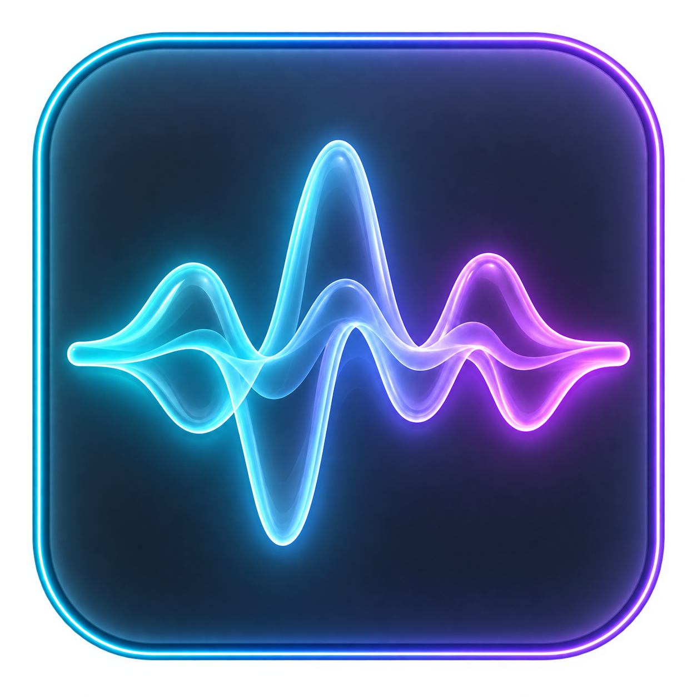
</p>

<h1 align="center">Plasma Ses Dalgası Görselleştirici</h1>

<p align="center"><a href="README.md">English</a> · <a href="README.tr.md">Türkçe</a></p>

<p align="center">
  <a href="https://muddyblack.github.io/audio-wave-visualizer/">
    
  </a>
  <a href="https://www.opendesktop.org/p/2359422/">
    
  </a>
  <a href="docs/gallery.md">
    
  </a>
</p>

<p align="center">
  
  <a href="LICENSE">
    
  </a>
  <a href="https://www.opendesktop.org/p/2359422/">
    
  </a>
  <a href="https://github.com/Muddyblack/audio-wave-visualizer/releases">
    
  </a>
  
</p>

<p align="center">
  <a href="#özellikler">Özellikler</a> ·
  <a href="#galeri">Galeri</a> ·
  <a href="#kendin-özelleştir">Kendin özelleştir</a> ·
  <a href="#gereksinimler">Gereksinimler</a> ·
  <a href="#kurulum">Kurulum</a> ·
  <a href="#nasıl-çalışır">Nasıl çalışır?</a> ·
  <a href="#destek">Destek</a>
</p>

<p align="center">
  
</p>

Bu araç, [cava][cava] ile sistem sesini izler; MPRIS oynatıcılarından albüm kapağını, parça bilgilerini ve oynatma denetimlerini gösterir. Hazır görünümlerden birini seçebilir veya yerleşik ayar stüdyosunda kendi görünümünüzü oluşturabilirsiniz.

Paneldeki hap biçimli mini görünüm, varsayılan olarak müziğe tepki veren küçük bir görselleştirici kullanır. Taşan metni kaydırmak için **Düzen → Parça metni → Uzun başlıkları kaydır** seçeneğini etkinleştirin. Hareket azaltma açıksa metin sabit kalır.

Parça bilgileri; seçilen alanları Parça, Katkıda Bulunanlar, Yayın ve Oynatma bölümlerinde gruplar. Araç ipucu kısa bir önizleme, çekmece ise bileşenin altında daha geniş bir panel açar. Kapak veya parça başlığının üzerine 350 ms gelindiğinde ayrıntı görünümü açılır; oynatma denetimleri ve parçada gezinme etkilenmez. Bilgi düğmesi tıklamayla açmak için de kullanılabilir; yalnızca üzerine gelmeyle açılması için “Bilgi görünümü düğmesini göster” seçeneğini kapatın. Geri dönmek için bileşenin dışına çıkın, Escape tuşuna basın veya × düğmesine tıklayın. Uzun ayrıntılar kaydırılabilir; ses düzeyi denetimleri oynatma denetimlerinin yanında kalır. Tek tıklamayla Temel, Katkıda Bulunanlar veya Tüm ayrıntılar seçeneklerinden birini seçebilir ya da alanları gruplara göre özelleştirebilirsiniz. “Beni şaşırt” ve günlük görünümler parça bilgisi ayarlarınızı korur.

**Çevrimiçi parça bilgileri varsayılan olarak kapalıdır.** Bunları ayar stüdyosunun Parça Bilgileri sekmesinden etkinleştirdiğinizde parça adı, sanatçı, albüm ve süre MusicBrainz'e; sanatçı adı ise İngilizce Wikipedia'ya gönderilebilir. Kayıt eşleşmeleri söz yazarları, besteciler, yapımcılar, icracılar, düzenlemeciler, sürüm notları ve ISRC kodları gibi bilgileri ekleyebilir. Plak şirketi, ülke ve baskı tarihi yalnızca belirli bir yayın tanımlandığında gösterilir. **Apple kataloğu için ayrı ve varsayılan olarak kapalı bir yedek arama seçeneği vardır:** çevrimiçi bilgilerle birlikte etkinleştirildiğinde eşleşmeyen parça ve sanatçı adları; albüm, tür, tarih ve parça ayrıntıları için Apple'ın herkese açık müzik kataloğuna gönderilebilir. Gösterilecek alanları siz seçersiniz. Oynatıcı üst verileri önceliklidir; belirsiz eşleşmeler tahmin edilmez. Kaynak bağlantıları kullanılan kataloğu belirtir. Sonuçlar, parça ve sağlayıcı ayarına göre ayrı ayrı yerel önbellekte 24 saat tutulur. Paylaşılan görünüm önayarları bu çevrimiçi seçenekleri etkinleştiremez.

[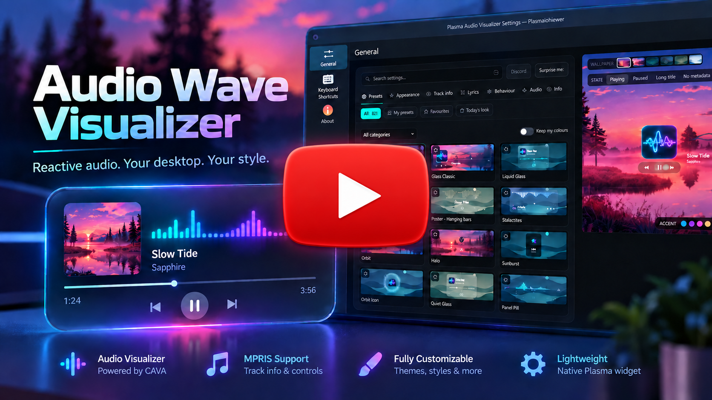](https://youtu.be/ytHqeP4cBgA)

## Özellikler

- **Hazır görünümler:** Kartlar, kapak görseli arka planları, posterler, kompakt şeritler, panel simgeleri ve daha fazlası.
- **Birçok ses görselleştiricisi:** Dalgalar, çubuklar, parçacıklar, halkalar ve diğer stiller [cava][cava] tarafından yakalanan sistem sesine tepki verir.
- **Yalnızca görselleştirici:** Saydam Neon Terrain için “Yalnızca görselleştirici” önayarını seçin veya herhangi bir efektle birlikte Düzen → Yalnızca görselleştirici seçeneğini kullanın. Bileşeni masaüstünde duvar kâğıdınıza uyacak şekilde boyutlandırıp konumlandırabilirsiniz.
- **Canlı ayar stüdyosu:** Düzenleri, renkleri, görselleştiricileri, ilerleme çubuklarını, kapak görsellerini ve hareketi özelleştirirken değişiklikleri anında önizleyin.
- **Önayar oluşturma ve paylaşma:** Kendi görünümlerinizi kaydedin; Plasma, Quickshell ve tarayıcı stüdyoları arasında JSON olarak paylaşın.
- **Özel QML stilleri:** Güvendiğiniz yerel QML dosyalarından kendi görselleştiricilerinizi ve ilerleme çubuklarınızı içe aktarın.
- **Albüm kapakları ve parça ayrıntıları:** Kapak görselini, başlığı, sanatçıyı, oynatma süresini ve isteğe bağlı kapak arka planını gösterin.
- **Oynatma denetimleri:** Destekleyen MPRIS oynatıcılarında oynatın, duraklatın, parça atlayın ve parçada ilerleyin.
- **Şarkı sözleri ve karaoke:** Kartta eşzamanlı bir satır gösterin veya yalnızca şarkı sözleri görünümüne geçin; yerel dosyaları ve isteğe bağlı çevrimiçi aramayı kullanın.
- **Plasma ve Hyprland:** Bileşeni KDE Plasma 6'da veya Hyprland üzerinde Quickshell ile kullanın.

## Galeri

Bunlar örnek oynatma ile gerçek QML bileşeninden alınmış görüntülerdir. Galeride [28 önayarın tamamı](docs/gallery.md) bulunur.

<details open>
  <summary><b>Kartlar</b></summary>
  <br/>
  <p align="center">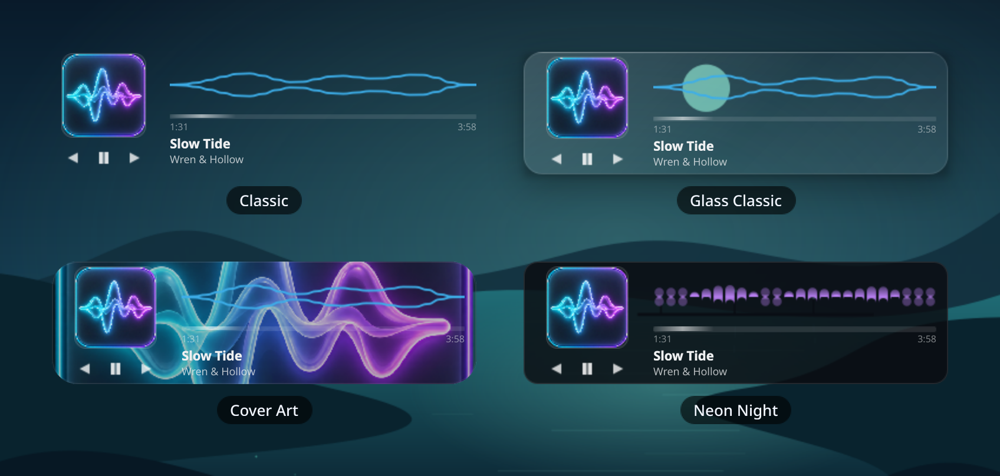</p>
</details>

<details>
  <summary><b>Yüzeyler ve oynatıcılar</b></summary>
  <br/>
  <p align="center">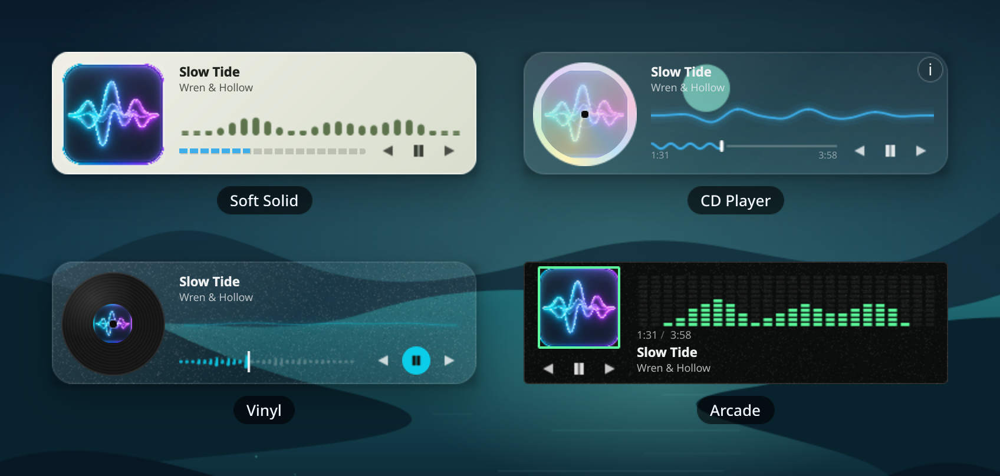</p>
</details>

<details>
  <summary><b>Üst üste cam katmanları</b></summary>
  <br/>
  <p align="center">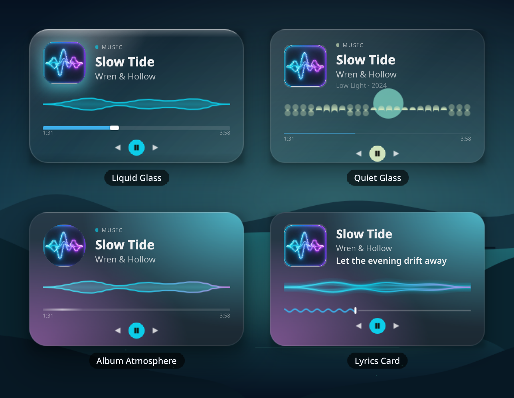</p>
</details>

<details>
  <summary><b>Posterler ve büyük görünümler</b></summary>
  <br/>
  <p align="center">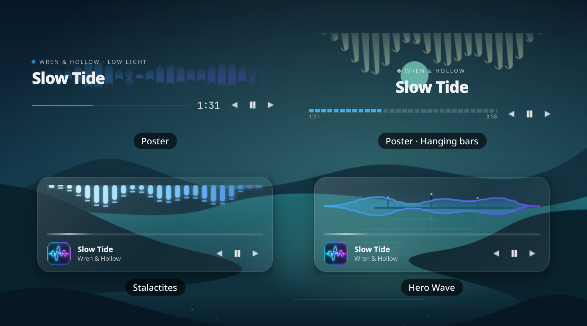</p>
</details>

<details>
  <summary><b>Yörüngeler ve şarkı sözleri</b></summary>
  <br/>
  <p align="center">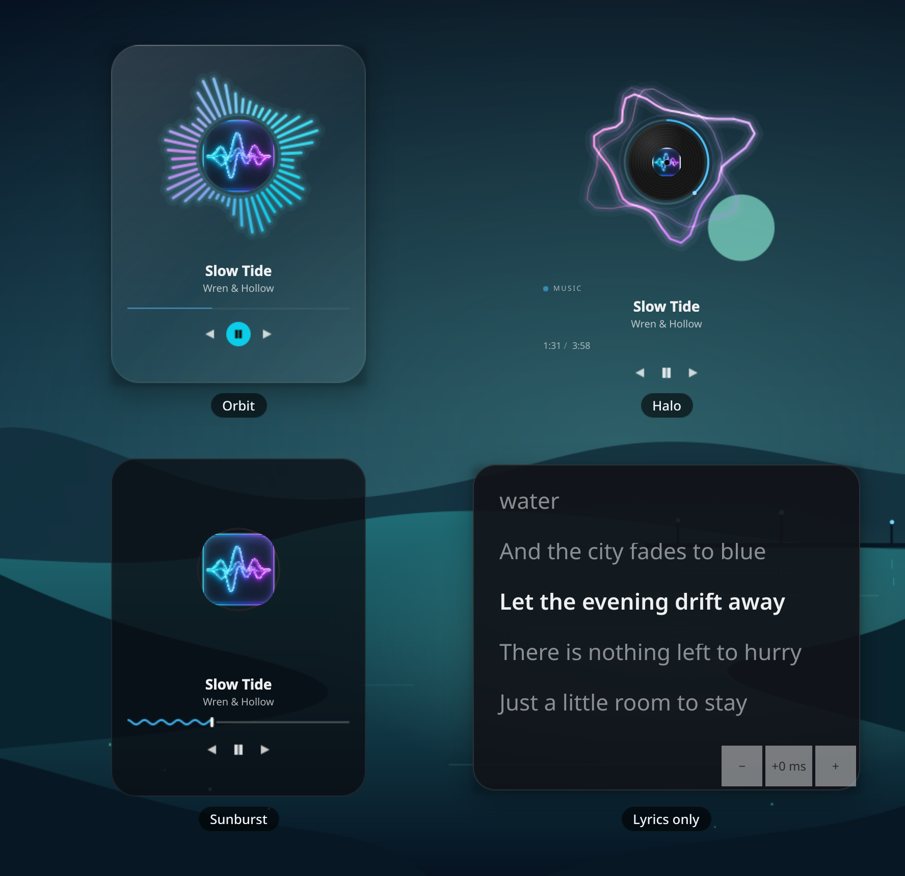</p>
</details>

<details>
  <summary><b>İnce ve sade görünümler</b></summary>
  <br/>
  <p align="center">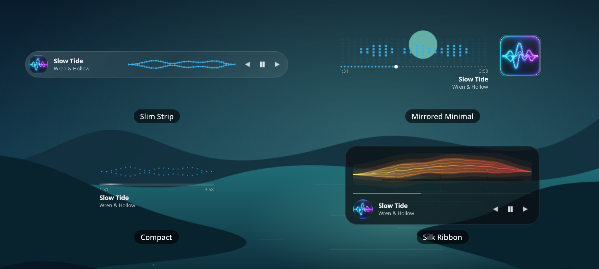</p>
</details>

<details>
  <summary><b>Panel düzenleri</b></summary>
  <br/>
  <p align="center">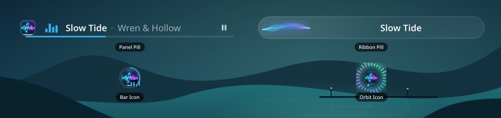</p>
</details>

## Kendin özelleştir

Birçok görselleştirici arasından seçim yapın, düzeni ve renkleri değiştirin, şarkı sözleri ekleyin ve değişiklikleri anında önizleyin. Kendi önayarlarınızı kaydedebilir, bileşen ile [tarayıcı stüdyosu](https://muddyblack.github.io/audio-wave-visualizer/) arasında JSON olarak paylaşabilirsiniz.

<p align="center">
  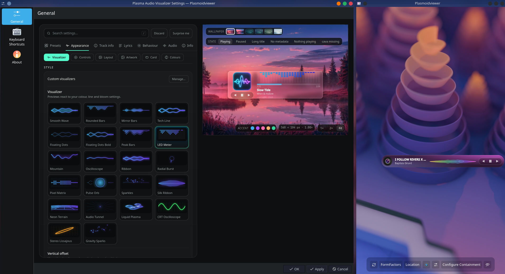
</p>

Plasma panelinde **Davranış → Panel yerleşimi → Görüntüleme → Otomatik**, bileşen yeterli genişlik ve yüksekliğe sahip olduğunda seçili kartı doğrudan gösterir; buna büyük yan paneller de dahildir. Küçük paneller hap biçimli görünüme veya simgeye döner. **Hap / simge** seçeneği her boyutta kompakt görünümü korur. **Otomatik** yönlendirme, hap biçimli görünümü yan panel boyunca döndürür ve sığması için gerekirse tam kartı çevirir. Bunu geçersiz kılmak için **Davranış → Panel yerleşimi** altından **Dik**, **Sola döndür** veya **Sağa döndür** seçin. Açılır pencereler dik kalır. **Panel hapı** ile **Kart / açılır pencere** ayrı tasarımlara ve canlı önizlemelere sahiptir. Kompakt görünümün açılır penceresini açmak için Düzen altında Üzerine gelme, Tıklama veya Her ikisi seçeneklerinden birini seçin; Düğmeler sekmesinden oynatma denetimleri ekleyin. **Uygula** her iki tasarımı da kaydeder. Masaüstü bileşenleri olağan düzenleyicilerini kullanmaya devam eder.

**Açılır pencere görünümünü kullan / Hap görünümünü kullan**, diğer tasarımın renklerini, kapak görselini ve efekt stillerini seçili tasarıma kopyalar. Hap görünümü kopyalanan görselleştirici ve ilerleme stillerini etkinleştirir. Her görünüm kendi düzenini ve oynatma denetimlerini korur. Uygula kopyayı kaydeder; Değişiklikleri At önceki tasarımları geri yükler. Eşitlemeden sonra da dışa aktarma, seçili görünümü JSON v1 olarak paylaşır. Eski önayar içe aktarımları desteklenmeye devam eder.

Açılır kartın sağ alt köşesindeki raptiye düğmesini kullanarak pencereyi diğer pencerelerin üzerinde açık tutabilirsiniz. Başka bir yere tıkladıktan sonra da açık kalır. Kapatmak için raptiyeye yeniden tıklayın veya Escape tuşuna basın.

Cam ve sıvı efektli açılır pencerelerde **Kartın arkasını bulanıklaştır** seçeneği **Kart / açılır pencere → Görünüm → Kart** altında bulunur. Plasma, tema çerçevesi ve gölgesi gizlenirken KWin'e yuvarlatılmış bir maske sağlar. Gerçek bulanıklık gücünü KWin'in Bulanıklık efekti belirler; duvar kâğıdı kaydırıcısı yalnızca önizlemeyi ayarlar. Yeni açılır pencere tasarımlarında bu özellik varsayılan olarak açıktır; kaydedilmiş seçimler korunur. Bu özellik Plasma'nın dahili SVG arka plan öğesini kullanır; öğe bulunamazsa kenarlıksız bir yedek kullanılır. Bir kabuk yardımcı aracı, oturumun çalışma dizininde her bileşen için tek bir küçük maske dosyası tutar ve yalnızca geometri değiştiğinde günceller. C++ eklentisi, derleme veya ek paket gerekmez.

Ayar stüdyosu hem Plasma hem de Quickshell ayarlarına yerleşik olarak dahildir. Tarayıcı sürümü, kurulum yapmadan aynı görünümleri keşfetmenizi sağlar. [Önayar paylaşımının nasıl çalıştığını](docs/sharing-presets.tr.md) öğrenin.

## Gereksinimler

- KDE Plasma **6.0+** (veya Hyprland için Quickshell)
- [`cava`][cava] — ses çubuklarını üreten araç
- Çalışan bir PipeWire veya PulseAudio sunucusu (bileşen, cava'nın hangisinden ses yakalayabildiğini otomatik algılar)
- `flock` (`util-linux` paketinden) ve `pkill` (`procps` paketinden) — neredeyse tüm Linux dağıtımlarında standarttır

[cava]: https://github.com/karlstav/cava

## Kurulum

Tüm kurulum seçenekleri ve yapılandırma ayrıntıları için [kurulum kılavuzuna](docs/installation.tr.md) bakın.

### KDE Plasma

<details open>
  <summary><b>Elle kurulum (her dağıtımda)</b></summary>

```bash
git clone https://github.com/Muddyblack/audio-wave-visualizer.git
cd audio-wave-visualizer
kpackagetool6 -t Plasma/Applet -i package
# veya mevcut bir kurulumu güncellemek için:
kpackagetool6 -t Plasma/Applet -u package
```

Ardından Plasma'nın **Araç Ekle** panelinden bileşeni ekleyin.

Kaldırmak için:

```bash
kpackagetool6 -t Plasma/Applet -r org.muddyblack.plasmaAudioVisualizer
```

</details>

<details>
  <summary><b>NixOS (flake)</b></summary>

```nix
# flake.nix
{
  inputs.audio-wave.url = "github:Muddyblack/audio-wave-visualizer";

  outputs = { self, nixpkgs, audio-wave, ... }: {
    nixosConfigurations.mybox = nixpkgs.lib.nixosSystem {
      modules = [
        ({ pkgs, ... }: {
          environment.systemPackages = [
            audio-wave.packages.${pkgs.system}.default
            pkgs.cava
          ];
        })
      ];
    };
  }
}
```

</details>

<details>
  <summary><b>KDE Store için <code>.plasmoid</code> paketi oluşturma</b></summary>

```bash
make pack
# plasma-audio-visualizer-<version>.plasmoid dosyasını oluşturur
```

</details>

### Hyprland / Quickshell

Bu depo kopyasında şu komutu çalıştırın:

```bash
make view-hyprland
```

Bileşen masaüstünüzde görünür. **Ayarlar** için sağ tıklayın; durdurmak için terminalde **Ctrl+C** tuşlarına basın. Başlatıcı Caelestia ile birlikte de çalışır. Oturum açılışında başlatma, ekran konumu, NixOS ve bileşen gizliyken ayarlara erişim için [kurulum kılavuzuna](docs/installation.tr.md#hyprland--quickshell) bakın.

### Windows (çalışır; gerçek Windows üzerinde henüz sınanmadı)

PySide6 tabanlı bir katman uygulaması aynı görselleştiriciyi görüntüler; cava yerine WASAPI döngü yakalama kullanır. Nasıl çalıştırıldığı, `make run-windows` komutu ve hangi özelliklerin doğrulanıp doğrulanmadığı için [docs/windows.tr.md](docs/windows.tr.md) belgesine bakın. Windows sürümünde henüz ayar arayüzü yoktur. Pencerenin sürekli altta kalma davranışı yalnızca teorik olarak değerlendirilmiş, gerçek bir Windows bilgisayarında denenmemiştir. Microsoft Store dağıtımı planlanmaktadır; henüz oluşturulmamıştır.

## Nasıl çalışır?

Mimari ve veri akışının ayrıntılı açıklaması için [Mimari Belgeleri](docs/workflow.tr.md) sayfasına bakın.

Kısaca: küçük bir kabuk yardımcı aracı (`feeder.sh`), arka planda `cava` çalıştırır ve değişen her kareyi `$XDG_RUNTIME_DIR/audio-wave-widget/` dizinine yazar. QML tarafı bu veriyi yapılandırılan kare hızında aynı süreç içinde okur; birkaç saniye sessizlikten sonra hızı 2 FPS'ye düşürür ve bileşen gizliyken yoklamayı durdurur.

Dalga biçimleri ve Orbit halkaları, desteklenen sahne grafiklerinde sınırlandırılmış parça gölgelendirici ailelerini kullanır; yazılım tabanlı oturumlarda Canvas yedeğine geçer. Parçacıkların durumu ses saatine göre ilerler. Yazılım kapakları statik kırpma/maskeleme yedeği kullanır. Bir gölgelendiriciyi düzenledikten sonra `make shaders` komutunu çalıştırın.

Gerileme testleri (sentetik ses kullanır; masaüstü veya ses sunucusu gerekmez):

```bash
nix develop --command python3 tests/run.py
```

Python lint ve biçimlendirme denetimleri için `make lint-python`; biçimlendirmeyi uygulamak için `make format-python` komutunu kullanın. Ruff, `nix develop` içinde veya doğrudan `nix run .#ruff -- check .` ve `nix run .#ruff -- format .` komutlarıyla da kullanılabilir. Ruff iş akışı, `flake.lock` dosyasında sabitlenen sürümü kullanarak çekme isteklerinde ve push işlemlerinde her iki denetimi de çalıştırır.

## Yardım ve proje belgeleri

- [Kurulum, yapılandırma ve sorun giderme](docs/installation.tr.md)
- [Tüm önayarların galerisi](docs/gallery.md)
- [Şarkı sözleri ve karaoke](docs/lyrics.tr.md)
- [Özel görselleştiriciler](docs/custom-visualizers.tr.md)
- [Mimari ve geliştirme iş akışı](docs/workflow.tr.md)

## Destek

Projeyi beğendiyseniz GitHub'da yıldız vererek veya küçük bir bağışla destek olabilirsiniz. :)

<p align="center">
  <a href="https://github.com/sponsors/muddyblack">
    
  </a>
  <a href="https://ko-fi.com/muddyblack">
    
  </a>
  <a href="https://buymeacoffee.com/muddyblack">
    
  </a>
</p>

## Katkı ve teşekkür

- [cava][cava], görselleştiriciler için ses yakalamayı sağlar.
- [LRCLIB](https://lrclib.net/), isteğe bağlı eşzamanlı şarkı sözlerini sağlar.
- [lumaribbon](https://github.com/Lucenx9/lumaribbon), görsel fikirler ve stüdyo konseptleri için ilham kaynağı olmuştur.

Bu projelerin geliştiricilerine ve katkı sunanlara teşekkürler. Bu proje [GPL-3.0](LICENSE) lisansı altında yayımlanır.
